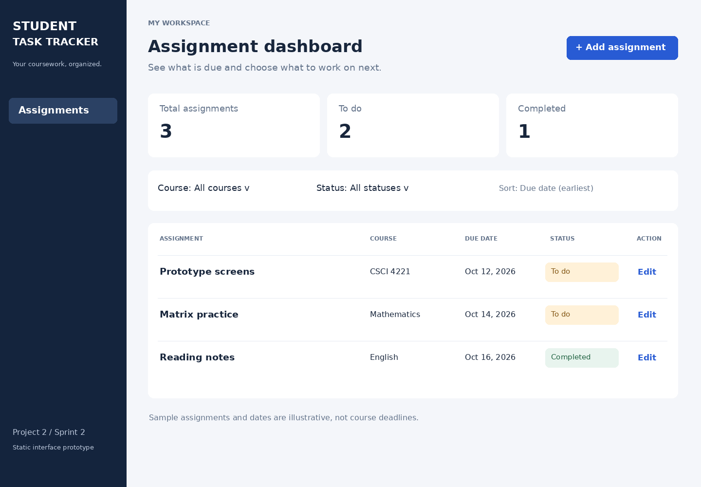
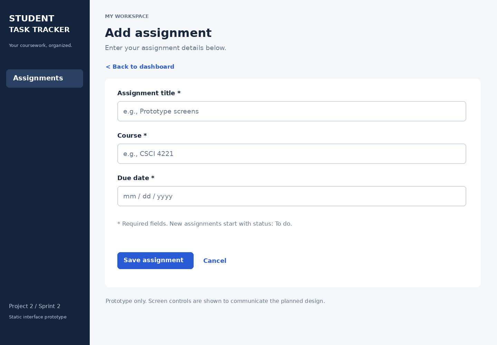
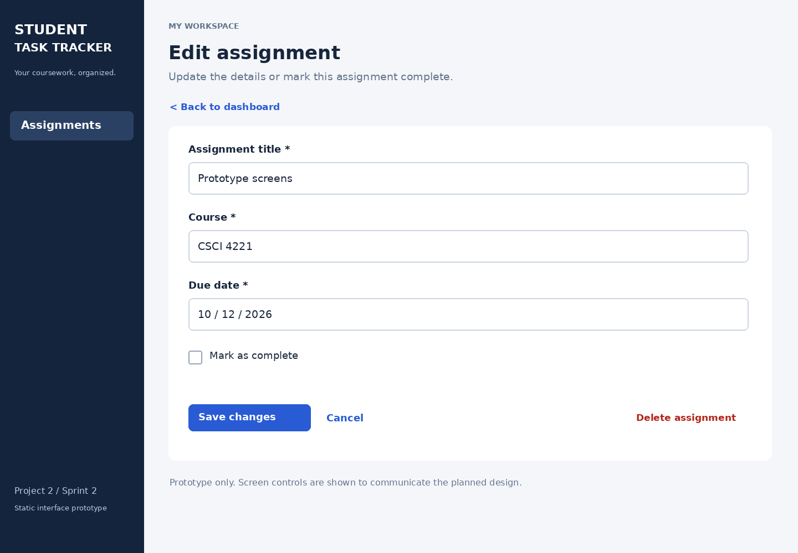

# Project 2: Student Task Tracker

**Student and sole contributor:** Tyjah Banks  
**Course:** CSCI4221  
**Instructor / ScrumMaster:** Prof. Wanjun Hu  
**Product owner:** Tyjah Banks  
**Development team:** Tyjah Banks  
**Sprint:** 2

## Project overview
I am completing Project 2 individually. My product continues the Student Task Tracker idea from Project 1. The proposed application helps college students organize assignments, due dates, courses, and completion status.

This submission includes three static prototype screens and descriptions of their intended behavior. The prototypes were prepared with AI assistance. They are not a working application.

## Prototype 1: Dashboard

The main screen displays assignments, upcoming deadlines, completion status, course and status filters, and Add and Edit actions.

## Prototype 2: Add Assignment

The entry screen provides required fields for title, course, and due date, with Save and Cancel actions.

## Prototype 3: Edit Assignment

The editing screen supports changing details, marking an assignment complete, and requesting deletion.

## Project documents
- [Design description and intended users](design-description.md)
- [Sprint 2 backlog](backlog.md)
- [Prototype review](prototype-review.md)
- [Solo planning record](meeting-notes/minutes_1.md)
- [Solo design progress record](meeting-notes/minutes_2.md)
- [Solo final review record](meeting-notes/minutes_3.md)

## Individual work and progress records
All Project 2 tasks are assigned to me. The three minutes files are prepared solo progress records, not claims of group meetings. I must add the actual session dates and confirm the summaries after performing the reviews. The course instructions specify group meetings; acceptance of individual progress sessions as a substitute is for the instructor to determine.

## Current status
The three prototype images, design explanation, backlog, and artifact review are complete. Three substantive individual progress records are included. Personal acceptance, actual session dates, repository setup verification, and submission remain to be completed. Sample dates shown in the screens are illustrative, not official assignment deadlines.
