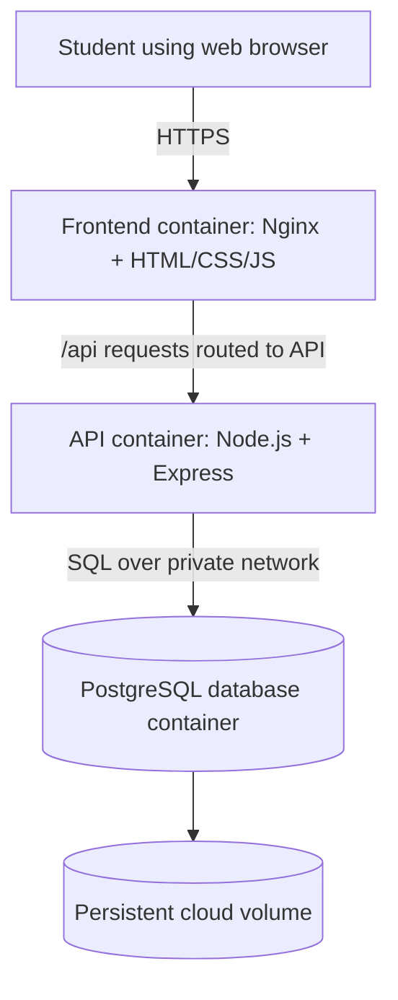
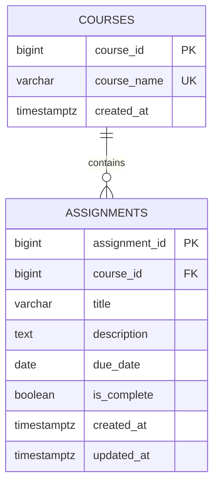

# Project 4 — Cloud Architecture for Student Task Tracker

**Name:** Tyjah Banks  
**Course:** CSCI4221  
**Instructor / ScrumMaster:** Prof. Wanjun Hu  
**Group:** 3  
**Product owner / contributor documented:** Tyjah Banks  
**Sprint:** 4  
**Product:** Student Task Tracker

## Project background and architecture goal

Student Task Tracker is the same project defined in Projects 1–3. It is intended to help college students manage course assignments in a single dashboard. The required features are (F1) add/edit/delete an assignment, (F2) view and filter assignments by course, status, and due date, and (F3) mark work complete and retain that status. This sprint describes how those features could run as cloud-based software; actual deployment and testing are future work.

# Section 1 — Description of the container

## 1.1 What software architecture means

Software architecture is a high-level plan showing a system's major components, how they communicate, how data is stored, and where the system runs. A design should also consider security, maintainability, performance, and reliability.

Three common architecture templates considered for this product are:

1. **Layered (three-tier) architecture:** presentation, application/business logic, and data storage are separate layers. This is the selected logical arrangement.
2. **Client–server architecture:** a student browser requests pages and data from a cloud-hosted server. Student Task Tracker uses this communication model.
3. **Microservices architecture:** separate small services independently handle features. This is not selected because it adds unnecessary complexity for the current small project.

The **selected design** is a small, containerized client–server application with three tiers. It uses separate Docker containers for a web frontend, an API, and PostgreSQL storage.

## 1.2 What cloud-based software is

Cloud-based software runs on internet-accessible computing infrastructure instead of depending on a program and data located only on one student's computer. Students would open a web address in a browser; the cloud host runs the containers and stores data. For classroom development, the same container design can be tested locally before deployment to a cloud virtual machine.

The first version is a **single-student demonstrator**, not a public multi-user system. Before public multi-user release, account authentication and per-user record isolation must be implemented. HTTPS, access controls, backups, and protected secrets are required for a real deployment.

## 1.3 Proposed architecture diagram



The frontend and API containers communicate on an internal Docker network. The database has **no publicly exposed port** in production. Docker Compose can define all three services for local development; a cloud VM or container platform can run them in deployment. A cloud load balancer or reverse proxy would provide HTTPS for users.

## 1.4 Docker, containers, daemon, and images

- **Docker:** A platform for packaging and running software consistently across computers and servers.
- **Container:** A running, isolated instance of an image with the code, dependencies, and configuration that a service needs.
- **Image:** A read-only template used to create a container. For example, a Node.js-based image supports the API, and an Nginx image serves the frontend.
- **Docker daemon (`dockerd`):** The background service that manages images, containers, networks, and volumes on a Docker host.
- **Dockerfile:** Instructions used to build a container image.
- **Docker Compose:** A YAML-based configuration that defines multiple related containers and their networks and volumes.

## 1.5 What is inside each proposed container?

| Container | Contents | Responsibility | Persistent data? |
| --- | --- | --- | --- |
| `tracker-web` | Nginx server, `index.html`, CSS, browser JavaScript, Nginx configuration | Serve dashboard and add/edit screens; forward `/api` calls | No |
| `tracker-api` | Node.js runtime, Express application, routes, validation, database client, dependencies | Validate assignment requests, implement business rules, read/write data | No |
| `tracker-db` | PostgreSQL server, schema and private database | Persist courses and assignments | Yes: Docker volume or managed disk |

**Example deployment arrangement:** One cloud virtual machine runs the containers using Docker Compose, with a persistent volume for the database. In a more production-oriented design, PostgreSQL would run as a managed cloud database rather than in a self-managed container. This is an architecture proposal, not a deployment record.

## 1.6 Typical user request

1. The student opens the dashboard on a laptop browser.
2. Nginx delivers the interface files.
3. The browser calls `GET /api/assignments` to load tasks, or `POST /api/assignments` to save a new one.
4. Express validates the data and sends parameterized SQL queries to PostgreSQL.
5. PostgreSQL returns records; Express sends JSON to the browser.
6. The dashboard refreshes the list and summary counts.

# Section 2 — Components and necessary files

## 2.1 Major components and sub-components

| Major component | Sub-components | Main responsibility |
| --- | --- | --- |
| Presentation / Frontend | Dashboard, Add Assignment form, Edit Assignment form, course/status filters, completion counter, API client | Display assignments and collect user input |
| Application / API | HTTP routes, input validation, assignment service, course service, database access, error handler | Apply the rules from Projects 1–3 and communicate with storage |
| Data / PostgreSQL | `courses` table, `assignments` table, indexes, constraints, persistent volume | Store task details and completion status reliably |
| Infrastructure / Docker | Dockerfiles, Compose services, internal network, environment configuration, health checks | Package components and prepare them for cloud hosting |

## 2.2 Proposed source files (implementation plan)

The following tree lists the **necessary files to implement** the design in a later development sprint. These application source files are not claimed to exist in this architecture-only submission.

```text
student-task-tracker/
├── frontend/
│   ├── index.html                 # Dashboard and task forms
│   ├── css/styles.css             # Layout and responsive styles
│   ├── js/app.js                  # UI events, filtering, rendering
│   ├── js/api.js                  # Calls to backend /api routes
│   ├── nginx.conf                 # Static hosting and API reverse proxy
│   └── Dockerfile                 # Nginx-based web image
├── backend/
│   ├── server.js                  # Express startup and error handling
│   ├── routes/assignments.js      # Task CRUD and completion routes
│   ├── routes/courses.js          # Course list and creation routes
│   ├── services/assignmentService.js # Validation and business rules
│   ├── db/connection.js           # PostgreSQL connection pool
│   ├── package.json               # Node dependencies and scripts
│   └── Dockerfile                 # Node.js API image
├── database/
│   └── schema.sql                 # PostgreSQL schema and indexes
├── compose.yaml                   # Frontend, API, database services
├── .env.example                   # Variable names only; NO passwords
└── .gitignore                     # Ignore real .env and local files
```

A version of `schema.sql` is included in this Project 4 documentation directory to show the proposed data structure; the tree above describes its future location in an implementation repository.

## 2.3 Ownership and sprint backlog

Since my Projects 2 and 3 were prepared individually, the contribution described here is my own assignment-management architecture and database table design. Other Group 3 members are not shown as attendees or as having completed work without their confirmation.

| PBI | Status for architecture document | Sprint | Estimate | Assigned | Reviewer |
| --- | --- | --- | --- | --- | --- |
| PBI-4.1: Compare cloud architecture options | Documented | 4 | 2 hours | Tyjah Banks | Self-review |
| PBI-4.2: Describe Docker and container roles | Documented | 4 | 2 hours | Tyjah Banks | Self-review |
| PBI-4.3: Define major components and necessary files | Documented | 4 | 3 hours | Tyjah Banks | Self-review |
| PBI-4.4: Design assignment-related database tables | Documented | 4 | 3 hours | Tyjah Banks | Self-review |
| PBI-4.5: Review architecture against user stories | Documented | 4 | 2 hours | Tyjah Banks | Self-review |
| PBI-4.6: Verify meeting records and publish repository | Not verified | 4 | 1 hour | Tyjah Banks | Instructor |

**My assigned component:** Assignment Management API (backend). It uses the shared database and the `assignments` table. Its planned files are `backend/routes/assignments.js`, `backend/services/assignmentService.js`, `backend/db/connection.js`, and relevant code in `backend/server.js`. The table structure I am responsible for is described in Section 3.

## 2.4 Planned API endpoints

| Method | Endpoint | Use |
| --- | --- | --- |
| GET | `/api/assignments` | List tasks, optionally filtered by course or completion state; sort by due date |
| POST | `/api/assignments` | Create a task (title, course, due date required) |
| PATCH | `/api/assignments/:id` | Edit task fields or completion status |
| DELETE | `/api/assignments/:id` | Delete a task after user confirmation in frontend |
| GET | `/api/courses` | Supply options for the course filter |

### Data and validation rules carried forward from Project 3

- Task title, course, and valid due date are required; trim blank text and report errors without erasing valid fields.
- Past due dates may be saved so an overdue assignment can be tracked.
- A new task begins as `To do`. Completion must be reversible.
- Lists are ordered by earliest due date, then title for ties.
- Course and completion filters can be combined. Dashboard counts refer to the full saved dataset, not the filtered subset.
- The frontend asks for confirmation before deletion; the backend actually deletes only after the delete request.
- API failures must be shown to the user. Database writes use parameterized SQL.

# Section 3 — Structure of the related table in the database

## 3.1 Database type and location

Use **PostgreSQL**, a relational SQL database. The data is kept in a **server-side shared database**, not in an individual browser. The database container has persistent volume storage, so restarting the API container does not erase assignments. This is a **design change** from the local browser storage proposed during Project 3 because Project 4 explicitly requires cloud software.

The database is private to the application network. In a future multi-user deployment, student accounts and ownership-based authorization must be added before any unrelated users can access it. It would be unsafe to expose a shared database publicly without those protections.

## 3.2 Main table: `assignments`

The assignment management component reads from and writes to this table.

| Column | PostgreSQL type | Key / constraint | Purpose |
| --- | --- | --- | --- |
| `assignment_id` | `BIGINT` | Primary key; generated identity | Unique assignment record |
| `course_id` | `BIGINT` | Foreign key to `courses.course_id`; required | Connect assignment to course |
| `title` | `VARCHAR(200)` | Not null; nonblank | Assignment title |
| `description` | `TEXT` | Optional | Additional directions or notes |
| `due_date` | `DATE` | Not null | Deadline used for ordering |
| `is_complete` | `BOOLEAN` | Not null; default false | To do vs. Completed |
| `created_at` | `TIMESTAMPTZ` | Not null; default current time | When record was made |
| `updated_at` | `TIMESTAMPTZ` | Not null; default current time | Last update time (API maintains it) |

**Example assignment:** `assignment_id=1`, `course_id=1`, `title='Essay outline'`, `due_date='2026-10-22'`, `is_complete=false`. This sample is illustrative and is not real student data.

## 3.3 Supporting table: `courses`

| Column | PostgreSQL type | Key / constraint | Purpose |
| --- | --- | --- | --- |
| `course_id` | `BIGINT` | Primary key; generated identity | Unique course |
| `course_name` | `VARCHAR(120)` | Not null; unique; nonblank | Course name, e.g. `CSCI4221` |
| `created_at` | `TIMESTAMPTZ` | Not null; default current time | When added |

One course can have many assignments; each assignment belongs to one course. The foreign key uses `ON DELETE RESTRICT` so a course with tasks cannot accidentally be deleted.

## 3.4 Relationship diagram



The full proposed `CREATE TABLE` statements and useful indexes are in [schema.sql](schema.sql).

## 3.5 Example queries and component/database relationship

- **Add:** API validates and runs `INSERT INTO assignments (...) VALUES (...) RETURNING *`.
- **View:** API joins `assignments` to `courses` and orders by `due_date ASC, title ASC`.
- **Filter:** API applies `course_id` and `is_complete` conditions when filters are chosen.
- **Complete:** API updates `is_complete` and `updated_at`; the same operation can set false again.
- **Delete:** API deletes by assignment ID after the frontend confirmation step.

## 3.6 Quality and risk considerations

| Concern | Proposed response |
| --- | --- |
| Lost data on container restart | Mount a persistent PostgreSQL volume and schedule backups |
| Unauthorized access | Use private DB networking, secrets outside Git, HTTPS; add authentication before public launch |
| Bad input | Validate title/course/date in API and add database constraints |
| API outage | Show readable error and avoid pretending a change was saved |
| Growth | Index course and due date columns; upgrade database capacity as needed |
| Project continuity | Map each planned endpoint and schema field to features and stories from Project 3 |

**Architecture deliverable status:** The proposed design and schema are documented. Source-code implementation, running containers, real cloud hosting, and verified team meeting attendance are not claimed as complete.
